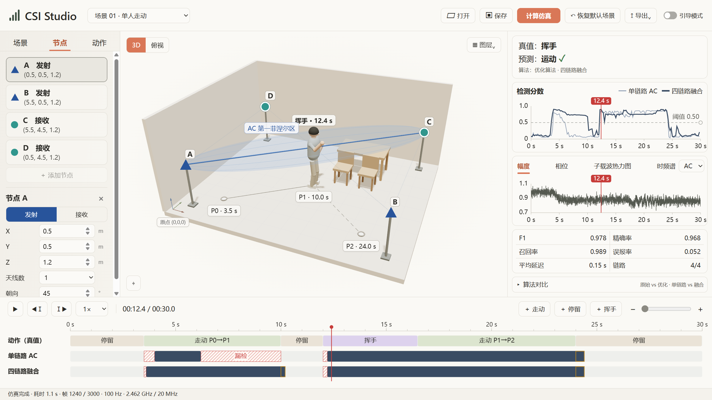

# 📡 CSI Studio

面向通信原理课程的 Wi-Fi CSI 人体运动感知仿真工具。在三维室内场景中布置收发节点、独立编排两人的轨迹和动作，沿时间轴观察混合 CSI 变化与逐人检测结果。

**[⬇️ 下载 Windows 版 v0.4.0](https://github.com/PatrickStar-cmd/-WiFi-CSI-/releases/download/v0.4.0/CSI.Studio.v0.4.0.Windows.zip)**（约 300 MiB）

[查看发行页面](https://github.com/PatrickStar-cmd/-WiFi-CSI-/releases/tag/v0.4.0)

## 🖼️ 界面预览

## ✨ 主要功能

| 功能 | 操作 |
| ---- | --- |
| 🏠 三维场景 | 在俯视图中摆放和旋转桌椅、绘制隔墙、布置收发节点。家具反射与隔墙损耗参与 CSI 计算。 |
| 🚶 动作编排 | 添加路径点，安排走动、停留和挥手，调整动作时长和运动参数。 |
| 👥 双人检测 | 分别编辑两人的轨迹、动作和活动区，用混合 CSI 生成逐人判定，同步回放并导出逐人指标。 |
| 📶 CSI 仿真 | 配置信号频率、带宽、采样率和信噪比，查看各链路的幅度、相位、子载波热力图和时频谱。 |
| 🎬 同步回放 | 播放或拖动时间轴，同步查看人物动作、检测分数和预测结果。 |
| 📊 检测对比 | 比较原始算法和优化算法，查看单链路与四链路融合的检测效果。拖动阈值线可即时更新判定和指标。 |
| 📤 结果导出 | 保存场景，导出界面图片、数据或汇报幻灯片。 |

## 🚀 快速上手

1. **启动程序**。下载 Windows ZIP，解压完整目录，双击 `CSI Studio.exe`。
2. **准备场景**。在顶部选择“04双人动静对照”进入双人模式，也可选择单人预设。在左侧面板调整房间、节点和动作。
3. **计算仿真**。点击 **计算仿真**，生成 CSI 数据和检测结果。
4. **查看回放**。播放或拖动底部时间轴，切换链路或展开 **算法对比**。
5. **保存结果**。点击 **保存**保留场景配置，或点击 **导出**生成所需文件。

## 🛠️ 源码指南

仿真源码、依赖文件和 Windows 打包脚本位于 [`Pre/WiFi_CSI_Simulation`](Pre/WiFi_CSI_Simulation)。源码启动、测试及构建命令见 [CSI Studio 使用说明](Pre/WiFi_CSI_Simulation/studio/README.md)。
